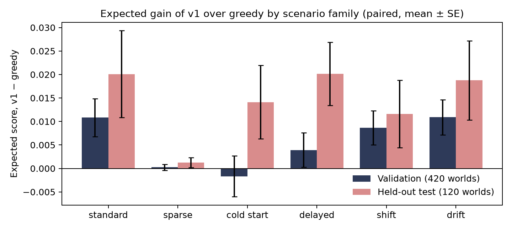

# Vouchsafe sequential matching policy (Team Outliers)

Final build for the CRSU x Romeo & Juliet Hackathon, Vouchsafe track, using starter kit 1.0.0. The submitted policy is `policy.py`, which we call v1. The full write-up is in [REPORT.md](REPORT.md).

All people and outcomes are synthetic, and the results describe this simulator only.

## What v1 does

The evaluator calls the policy twice per simulated day: once to ask clarification questions and once to propose introductions. v1:

1. Asks for the hard-constraint bundle from the incomplete members who could unlock the most possible partners (four members a day within the 12-unit budget).
2. Introduces the largest possible set of compatible, non-overlapping pairs, using general maximum-cardinality matching from NetworkX. Among equally large sets, it prefers people who have not been introduced yet, then pairs who share more soft preferences.
3. Checks every ask and pair against the simulator's rules before returning them, and falls back to simpler valid actions if anything goes wrong.

It reads only the JSON request, has no trained parameters and uses no randomness.

## Results

Official evaluator, public seeds 101 to 103 in all six scenario families (18 episodes per policy):

| | v1 (submitted) | greedy | random | no asks |
|---|---:|---:|---:|---:|
| Valid episodes | 18/18 | 18/18 | 18/18 | 18/18 |
| Primary score (MSMI per 100 arrived members) | 0.333 | 0.389 | 0.278 | 0.139 |
| Coverage (share of members introduced at least once) | 0.379 | 0.372 | 0.377 | 0.143 |
| MSMI pairs, total over 18 episodes | 12 | 14 | 10 | 5 |

On these episodes v1 is two MSMI pairs behind greedy, which is within noise: one pair moves the score by about 0.028. Because successes are this rare, we compared policies with an offline research harness that also computes the expected number of MSMI pairs from the simulator's hidden probabilities after each episode. The policy never sees those values. Paired against greedy on the same worlds:

| Worlds | Expected score, v1 − greedy (mean ± SE) |
|---|---:|
| Public seeds 101–103 (18 worlds) | −0.0002 ± 0.0049 |
| Validation seeds 2000–2069 (420 worlds) | +0.0055 ± 0.0015 |
| Held-out test seeds 3000–3019 (120 worlds), run once after freezing v1 | +0.0143 ± 0.0030 |

The gain is small but consistent. On the test split it is positive in all six families. The report covers scenario-level results, coverage, waiting times, ask cost, missing feedback, runtime, ablations and failure cases.



## Where to find each required item

| Requirement in `docs/SUBMISSION.md` | Where it is |
|---|---|
| Policy source and Dockerfile with all inference assets | `policy.py`, `Dockerfile`, `vendor/networkx/` |
| Setup and evaluation commands, Python and dependency versions, training and inference seeds | This README: [Environment](#environment), [Commands](#commands), [Seeds](#seeds) |
| Full-episode results for greedy, no clarification, random feasible and v1 on the same seeds and scenarios | `results/baseline_greedy.json`, `results/baseline_no_asks.json`, `results/baseline_random.json`, `results/final.json` |
| Scenario outcomes, coverage, waiting times, clarification cost, missing feedback, runtime | `REPORT.md` Sections 5 and 9 |
| Hypothesis-driven ablation and limitations | `REPORT.md` Sections 1, 7 and 10 |
| Provenance, dependency licences, training compute | `THIRD_PARTY_NOTICES.md`, `REPORT.md` Section 4 |
| Product integration note | `REPORT.md` Section 11 |

## Environment

| Item | Value |
|---|---|
| Python | 3.12.7 in Docker (`python:3.12.7-slim`). Local runs need Python 3.10 or later; CI tests 3.10 and 3.12. |
| Inference dependencies | Standard library plus NetworkX 3.4.2, vendored in `vendor/`. Nothing needs installing, and the image builds without network access or credentials. |
| Training seeds | None. v1 has no trained parameters. |
| Inference random seed | None needed. v1 is deterministic. (The supplied random baseline uses `random.Random(17 + day)`.) |
| Hardware | CPU only. The slowest call takes about 0.43 s in-process, or 0.84 s including Python startup, against the 10 s limit. |

## Commands

Run from the repository root:

```bash
python -m unittest -v
python verify_data.py
python evaluate.py --seeds 101,102,103 --variants all --output results/final.json
docker build -t sequential-policy:submission .
python evaluate.py --image sequential-policy:submission --seeds 101 --output results/container_check.json
```

To regenerate every official-evaluator result (v1, the three baselines and four ablations; about 1.5 hours on 2 cores):

```bash
./run_experiments.sh
```

- Baselines: `python evaluate.py --policy baselines.py --baseline greedy|no_asks|random ...`. `baselines.py` is the unchanged starter policy.
- Ablations: `POLICY_CONFIG=<name> python evaluate.py --policy policy.py ...`, where `<name>` is `targeted_asks_only`, `maxcard_only`, `maxcard_newcomer_only` or `v1_no_newcomer_bonus`.
- `policy.py` accepts the runner's `--baseline` argument and ignores it, so it always runs v1 unless `POLICY_CONFIG` is set. The container needs no arguments.

Research results (offline only, needs NumPy and Matplotlib, not part of the Docker image; about an hour on 2 cores):

```bash
pip install -r requirements-research.txt
python research/compare.py --policies greedy,no_asks,targeted_asks_only,maxcard_only,maxcard_newcomer_only,v1_no_newcomer_bonus,v1 --seeds 2000-2019 --out results/research_ablation.json > results/research_ablation.txt
python research/compare.py --policies greedy,v1 --seeds 2000-2069 --out results/research_validation.json > results/research_validation.txt
python research/compare.py --policies greedy,v1 --seeds 3000-3019 --out results/research_test_split_expected.json > results/research_test_split.txt
python research/compare.py --policies greedy,no_asks,v1 --seeds 101-103 --out results/research_public_check.json > results/research_public_check.txt
python research/oracle_ranking.py --seeds 101-105,2000-2019 --out results/research_oracle_ranking.json > results/research_oracle_ranking.txt
python research/checks.py
python research/make_figures.py
```

## Seeds

| Split | Seeds | Used for |
|---|---|---|
| Public | 101–103 | Official evaluator runs in `results/` and the harness check |
| Validation | 2000–2069 | Development (2000–2019, also the ablation set) and validation (2020–2069) |
| Test | 3000–3019 | One final run of the frozen v1 |

## Files

| Path | Contents |
|---|---|
| `policy.py` | Submitted policy (v1) and the ablation configurations |
| `test_policy_v1.py` | Tests for the interface, validity, fallback and Docker packaging |
| `Dockerfile`, `.dockerignore` | Offline image containing `kit.py`, `policy.py` and `vendor/` |
| `vendor/networkx/` | NetworkX 3.4.2, vendored (licence in `THIRD_PARTY_LICENSE_networkx.txt`) |
| `run_experiments.sh` | Regenerates all official-evaluator JSON in `results/` |
| `results/` | Machine-readable results: official runs, container check and research runs |
| `REPORT.md`, `docs/figures/` | Technical report with the product integration note, and its figures |
| `research/` | Offline research harness, comparisons, ranking diagnostic, checks and figure scripts (not used by the policy) |
| `requirements-research.txt` | Research-only dependencies |
| `THIRD_PARTY_NOTICES.md` | Provenance, licences and tools |
| `LICENSE-TEAM` | MIT licence for the team's own code and documents |
| `baselines.py` | The supplied starter policy (greedy, no asks and random baselines), unchanged |
| `KIT_README.md` | The organisers' original README |
| Other files | Starter kit 1.0.0, unchanged: `kit.py`, `evaluate.py`, `organise.py`, kit tests, `data/`, `docs/`, `examples/` |

## Licence

The team's code and documents are under the MIT licence in `LICENSE-TEAM`. Starter-kit files keep the organisers' `LICENSE` and `DATA_LICENSE.md`. NetworkX is BSD-3-Clause.
