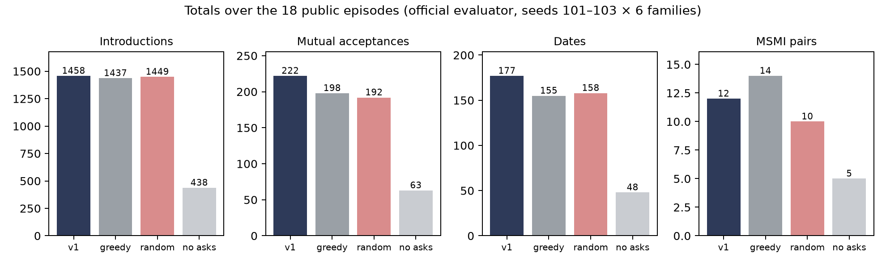
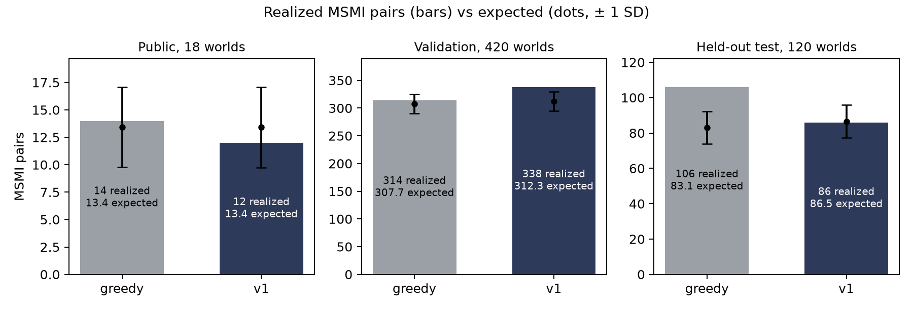
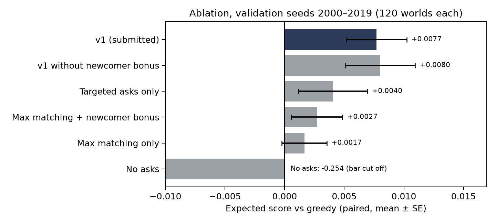

# Technical report: getting more compatible pairs introduced in time

Team Outliers, CRSU x Romeo & Juliet Hackathon, Vouchsafe track, Round 2 final build. Submitted policy: v1 (`policy.py`). Starter kit 1.0.0.

All people and outcomes here are synthetic. The results describe this simulator only, not real members.

## Summary

Each simulated day, v1 spends the clarification budget on the members whose answers could unlock the most possible partners, then introduces the largest possible set of compatible pairs. Every action is checked against the simulator's rules before it is returned. There is no training and no randomness.

- v1 returned valid actions in every episode we ran: the 18 official public episodes, the offline container check, and 678 episodes in our research harness.
- On the official public runs, v1 scores 0.333 and greedy 0.389. That is 12 MSMI pairs against 14 over 18 episodes, which is within noise. v1 reaches more members (coverage 0.379 against 0.372) and gets more mutual acceptances (222 against 198).
- Because MSMI outcomes are rare, we chose the policy using expected MSMI computed offline from the simulator's hidden probabilities (Section 6). Against greedy, v1 gains +0.0055 ± 0.0015 on 420 validation worlds and +0.0143 ± 0.0030 on 120 held-out test worlds, which we ran once after freezing the policy. The test gain is positive in all six families.
- The gain is small. We estimate that v1 beats greedy on a 120-episode private evaluation about 54% to 61% of the time (Section 6).

All ± values in this report are one standard error. Scores are MSMI (both people say they want to meet again) per 100 arrived members, the official primary score.

## 1. Hypothesis and objective

To produce an MSMI, a pair must first be introduced. That requires both people to be available at the same time, to have all their hard constraints known, and to be compatible. Our hypothesis is that the score is limited mainly by how many compatible pairs get introduced before people become busy, paused or leave, and much less by which compatible pairs are chosen.

Two results point this way. Removing clarification costs −0.254 in expected score (Section 7), about 70% of greedy's expected score, so getting hard constraints answered matters a great deal. Choosing better pairs matters much less. In a diagnostic, we let greedy rank pairs by their true hidden success probability, which no real policy can see (`research/oracle_ranking.py`). This perfect ranking raised the expected score by +0.0189 ± 0.0026 on the 120 ablation worlds (seeds 2000 to 2019), about 5% of greedy's expected score, and by +0.0099 ± 0.0032 on seeds 101 to 105, close to the +0.012 in our Round 1 note. A real model could recover only part of that.

So v1 does not try to predict who will get along. Each day it aims to:

1. use the 12-unit ask budget (four constraint bundles at 3 units each) on the incomplete members who could make the most new pairs feasible;
2. introduce a maximum set of non-overlapping feasible pairs;
3. never break a hard constraint and never return an action the simulator would reject.

## 2. Method

**Feasibility.** A pair is proposed only if both members are available, both have every hard field observed, they have not been introduced before, and the kit's `eligibility()` returns `feasible` in both directions. A missing hard field never counts as a pass, and a known hard failure always blocks the pair.

**Clarification.** The candidates are the same as in the baseline: available members with at least one unknown hard field and no declined hard field. v1 ranks them by how many partners they could unlock. It counts the other members who are not paused, have not declined a hard field, have not already been introduced to the candidate, and are not already known to be incompatible with them. A complete member counts 1 and an incomplete one counts 0.5. Ties go to the earliest arrival, then the lowest ID. Members who declined a hard field are never asked again, because their profile can never become complete.

**Allocation.** The compatibility graph is not two-sided: whether two people can be paired depends on both people's stated preferences, not on a fixed split into two groups. So v1 uses general matching, `networkx.max_weight_matching(..., maxcardinality=True)`. Each edge has weight 1 + 0.5 × (number of people in the pair who have never been introduced) + 0.01 × (number of shared observed soft fields). Maximum cardinality is enforced first, so the weights only choose between matchings of the same size. Soft fields never override a hard constraint.

**Waiting.** v1 never holds pairs back. If a feasible pair fits in the maximum matching, it is introduced that day. Members with no feasible partner wait and stay in the unserved count.

**Safety layer.** Before returning, v1 removes any ask or pair the simulator would reject: unknown or unavailable IDs, duplicate asks, going over budget, one person in two pairs, repeated pairs and infeasible pairs. If a component raises an error, v1 falls back to the baseline asks and greedy matching. If that also fails, it returns an empty, valid response. If a call has already run for more than 6 seconds, it switches to the cheaper greedy matcher. We built it this way because one invalid assessed episode makes a submission ineligible.

## 3. Inputs, missing data and leakage

- **Inputs.** v1 reads only the request (`state` and `memory`). From the state it uses `fields`, `field_status`, `available`, `arrived_day`, `introductions` and `feedback`. Feedback is used only to spot members who are paused after mutual interest. The memory it receives is returned unchanged (`{}` in practice), so nothing is carried between calls.
- **Unknown and declined answers.** A field that has not been asked stays unknown. In the kit a declined answer can never be revealed, so it blocks that member permanently. v1 never guesses a missing value.
- **Missing and delayed feedback.** v1 does not learn from outcomes, so missing feedback is never read as a "no" and delays cannot bias it. It does no exploration.
- **Cold start and uneven history.** New members are treated like everyone else: they are asked as soon as they rank high enough, and the newcomer bonus favours people with no introductions when two matchings are the same size. v1 does not score people on their past outcomes, so members with long histories get no advantage.
- **Leakage.** Hidden simulator values (true fields, response rates, success probabilities) are used only by the offline code in `research/`, after each episode has finished. `policy.py` never imports that code, and the kit's `test_runner.py` checks that hidden world fields never reach the policy. All settings were fixed before the test split was run.

## 4. Training, assets and randomness

There is no training, no learned parameter, no external data, no pretrained model and no network access at inference. The only added inference dependency is NetworkX 3.4.2 (BSD-3-Clause), vendored in `vendor/` so the Docker build needs no network. v1 is deterministic, so it needs no inference seed. Provenance and licences are listed in `THIRD_PARTY_NOTICES.md`.

We used AI coding assistants for parts of the code, analysis and writing. The team reviewed the code and ran every experiment reported here.

## 5. Official evaluator results

Public seeds 101 to 103 in all six scenario families give 18 episodes per policy. All runs use `evaluate.py` with one real subprocess per call and identical seeds and families. The commands are in `run_experiments.sh`, and each run is a JSON file in `results/` (ablation rows come from `results/ablation_<name>.json`). Every run is eligible (`"eligible": true`). The kit calls the standard family `development`.

**Table 1. Overall results (18 episodes per policy)**

| Policy | Valid episodes | Primary score | ± SE | Coverage | Mutual acceptances per 100 | Ask cost per episode |
|---|---|---:|---:|---:|---:|---:|
| v1 (submitted) | 18/18 | 0.333 | 0.081 | 0.379 | 6.17 | 207 |
| greedy | 18/18 | 0.389 | 0.065 | 0.372 | 5.50 | 207 |
| no asks | 18/18 | 0.139 | 0.054 | 0.143 | 1.75 | 0 |
| random | 18/18 | 0.278 | 0.083 | 0.377 | 5.33 | 207 |
| targeted asks only | 18/18 | 0.444 | 0.114 | 0.370 | 6.36 | 207 |
| max matching only | 18/18 | 0.306 | 0.082 | 0.374 | 5.69 | 207 |
| max matching + newcomer bonus | 18/18 | 0.278 | 0.060 | 0.379 | 5.64 | 207 |
| v1 without newcomer bonus | 18/18 | 0.333 | 0.081 | 0.373 | 6.72 | 207 |

**Table 2. MSMI per 100 arrived members by family (mean of seeds 101 to 103)**

| Policy | development | sparse | cold_start | delayed | shift | drift |
|---|---:|---:|---:|---:|---:|---:|
| v1 (submitted) | 0.500 | 0.000 | 0.333 | 0.500 | 0.333 | 0.333 |
| greedy | 0.500 | 0.167 | 0.167 | 0.500 | 0.500 | 0.500 |
| no asks | 0.167 | 0.000 | 0.000 | 0.333 | 0.167 | 0.167 |
| random | 0.333 | 0.167 | 0.167 | 0.167 | 0.500 | 0.333 |
| targeted asks only | 0.500 | 0.000 | 0.333 | 0.833 | 0.500 | 0.500 |
| max matching only | 0.500 | 0.167 | 0.000 | 0.167 | 0.500 | 0.500 |
| max matching + newcomer bonus | 0.333 | 0.167 | 0.000 | 0.333 | 0.500 | 0.333 |
| v1 without newcomer bonus | 0.500 | 0.000 | 0.333 | 0.500 | 0.333 | 0.333 |

**Table 3. Coverage by family (share of arrived members with at least one introduction)**

| Policy | development | sparse | cold_start | delayed | shift | drift |
|---|---:|---:|---:|---:|---:|---:|
| v1 (submitted) | 0.438 | 0.145 | 0.380 | 0.435 | 0.438 | 0.438 |
| greedy | 0.432 | 0.145 | 0.360 | 0.430 | 0.432 | 0.432 |
| no asks | 0.183 | 0.043 | 0.080 | 0.183 | 0.183 | 0.183 |
| random | 0.440 | 0.145 | 0.363 | 0.438 | 0.433 | 0.440 |
| targeted asks only | 0.428 | 0.145 | 0.367 | 0.425 | 0.428 | 0.428 |
| max matching only | 0.433 | 0.145 | 0.368 | 0.433 | 0.432 | 0.433 |
| max matching + newcomer bonus | 0.440 | 0.145 | 0.375 | 0.438 | 0.438 | 0.440 |
| v1 without newcomer bonus | 0.433 | 0.145 | 0.365 | 0.430 | 0.433 | 0.433 |

**Table 4. Outcome funnel (totals over 18 episodes)**

Missing feedback counts responses that never arrived. v1 never treats them as a rejection.

| Policy | Introductions | Mutual acceptances | Dates | MSMI pairs | Missing feedback |
|---|---:|---:|---:|---:|---:|
| v1 (submitted) | 1458 | 222 | 177 | 12 | 741 |
| greedy | 1437 | 198 | 155 | 14 | 819 |
| no asks | 438 | 63 | 48 | 5 | 240 |
| random | 1449 | 192 | 158 | 10 | 754 |
| targeted asks only | 1404 | 229 | 178 | 16 | 744 |
| max matching only | 1430 | 205 | 172 | 11 | 803 |
| max matching + newcomer bonus | 1441 | 203 | 170 | 10 | 816 |
| v1 without newcomer bonus | 1431 | 242 | 193 | 12 | 694 |

**Table 5. Waiting, clarification cost and runtime (totals over 18 episodes, 3,600 arrived members)**

Waiting times are days from arrival to first introduction, pooled over served members. Unserved members are counted, not dropped.

| Policy | Served | Unserved | Median first wait | 90th percentile wait | Ask cost | Inference seconds per episode (mean, max) |
|---|---:|---:|---:|---:|---:|---|
| v1 (submitted) | 1365 | 2235 | 3 | 16 | 3720 | 15.8, 23.4 |
| greedy | 1338 | 2262 | 4 | 16 | 3720 | 10.1, 11.1 |
| no asks | 514 | 3086 | 0 | 13 | 0 | 11.5, 13.5 |
| random | 1356 | 2244 | 5 | 16 | 3720 | 10.4, 12.2 |
| targeted asks only | 1333 | 2267 | 4 | 16 | 3720 | 7.2, 9.0 |
| max matching only | 1347 | 2253 | 4 | 16 | 3720 | 15.5, 23.2 |
| max matching + newcomer bonus | 1366 | 2234 | 4 | 16 | 3720 | 14.6, 15.4 |
| v1 without newcomer bonus | 1344 | 2256 | 3 | 16 | 3720 | 15.8, 20.3 |



*Figure 1. Introductions, mutual acceptances, dates and MSMI pairs for v1 and the three baselines on the 18 public episodes (from `results/final.json` and `results/baseline_*.json`).*

**How to read these numbers.** MSMI pairs are rare here: between 5 and 16 per policy across 18 episodes, and a single pair moves the score by about 0.028. Paired over the same 18 worlds, the realized difference v1 − greedy is −0.056 ± 0.080. v1 was better in 3 worlds, equal in 10 and worse in 5. That is within noise. On the same worlds our research harness reproduces the official runs exactly (Section 6) and gives an expected difference of −0.0002 ± 0.0049, so neither policy had a real edge on these particular worlds. The clearer differences are elsewhere in the funnel: v1 reached more distinct members (coverage +0.0075 ± 0.0024), with more mutual acceptances (222 against 198) and more dates (177 against 155). We did not choose the submitted policy from these 18 worlds.

## 6. Lower-noise evidence: expected MSMI on many worlds

Realized MSMI is too rare to compare policies on a handful of worlds. For research only, after each episode has finished, we compute the exact probability that each introduction ends in MSMI before the episode ends, using the simulator's hidden values, and add these up (`research/harness.py`). We report this expected score in the same units as the primary score. The policy never sees these values.

We checked the measure in two ways.

- **Same actions as the official evaluator.** The harness runs the official `evaluate.episode` loop with in-process policy calls. On all 18 public episodes it produced exactly the same actions and outcomes as the official evaluator for v1, greedy and no asks, which is 54 of 54 episodes (`python research/checks.py`). It also shows that, on these episodes, the `greedy` and `no_asks` configurations in `policy.py` act exactly like the starter baselines.
- **Realized results agree with expected ones** (Table 7 and Figure 3). The measure does not flatter v1. On the test split, v1's realized count matched its expectation, while greedy's was 2.5 standard deviations above its own.

**Table 6. Expected score and coverage, v1 − greedy, paired on the same worlds**

| Worlds | Seeds | Number of worlds | Expected score | Coverage |
|---|---|---:|---:|---:|
| Public | 101–103 | 18 | −0.0002 ± 0.0049 | +0.0075 ± 0.0022 |
| Ablation set | 2000–2019 | 120 | +0.0077 ± 0.0025 | +0.0044 ± 0.0008 |
| Validation, fresh worlds | 2020–2069 | 300 | +0.0046 ± 0.0018 | +0.0046 ± 0.0004 |
| Validation, all | 2000–2069 | 420 | +0.0055 ± 0.0015 | +0.0046 ± 0.0004 |
| Held-out test, run once | 3000–3019 | 120 | +0.0143 ± 0.0030 | +0.0059 ± 0.0007 |

Standard errors here are combined across families, so they differ slightly from the simple paired standard errors in Section 5. Files: `results/research_public_check.json`, `research_ablation.json`, `research_validation.json` (the 2020–2069 row is a subset of it) and `research_test_split_expected.json`, each with a `.txt` summary.


*Figure 2. Expected gain of v1 over greedy in each scenario family, on validation (420 worlds) and held-out test (120 worlds) seeds. Error bars are one standard error.*

**Table 7. Realized against expected MSMI pairs**

z = (realized − expected) / √expected.

| Worlds | Policy | Realized | Expected | z |
|---|---|---:|---:|---:|
| Public 101–103 | greedy | 14 | 13.4 | +0.2 |
| Public 101–103 | v1 | 12 | 13.4 | −0.4 |
| Validation 2000–2069 | greedy | 314 | 307.7 | +0.4 |
| Validation 2000–2069 | v1 | 338 | 312.3 | +1.5 |
| Test 3000–3019 | greedy | 106 | 83.1 | +2.5 |
| Test 3000–3019 | v1 | 86 | 86.5 | −0.1 |



*Figure 3. Realized MSMI pairs (bars) against expected pairs (dots, ± one standard deviation) for greedy and v1.*

**Final check on the held-out test split.** We froze v1 and ran seeds 3000 to 3019 once, at the end. The expected gain was positive in every family: standard +0.020, sparse +0.001, cold start +0.014, delayed +0.020, shift +0.012 and drift +0.019. Coverage rose by 0.59 ± 0.07 percentage points. The realized counts went the other way: 86 MSMI pairs for v1 against 106 for greedy (−0.083 ± 0.052). v1's 86 is in line with its expected 86.5, while greedy's 106 is about 2.5 standard deviations above its expected 83.1. We read this as greedy getting lucky outcome draws. It also shows how much a single evaluation can swing.

**What the gain means for one private evaluation.** The private evaluation has 120 episodes. A gain of +0.0055 is about 1.3 extra MSMI pairs over 120 episodes, while the realized difference between two policies varies by about ±12 pairs (one standard deviation, estimated from the test split). So v1 would beat greedy on a single private evaluation about 54% of the time, or about 61% if the test-split gain is the true one. It is a modest improvement, not a guaranteed win.

## 7. Ablation

**What we tested.** If the hypothesis is right, the two parts should help each other: targeted asks make more members complete, and maximum matching introduces more of them. Each part alone should give a small gain, and the two together a larger one. We ran every configuration on the same 120 research worlds and on the official public runs.

**Table 8. Ablation.** Expected score and coverage are each configuration minus greedy, paired on seeds 2000 to 2019 (120 worlds).

| Configuration | Asks | Matching | Expected score vs greedy | Coverage vs greedy | Official public score |
|---|---|---|---:|---:|---:|
| greedy (reference) | baseline | greedy | 0 | 0 | 0.389 |
| no asks | none | greedy | −0.2542 ± 0.0065 | −0.2160 ± 0.0032 | 0.139 |
| max matching only | baseline | maximum, no newcomer bonus | +0.0017 ± 0.0019 | +0.0007 ± 0.0005 | 0.306 |
| max matching + newcomer bonus | baseline | maximum | +0.0027 ± 0.0021 | +0.0041 ± 0.0008 | 0.278 |
| targeted asks only | targeted | greedy | +0.0040 ± 0.0029 | −0.0007 ± 0.0005 | 0.444 |
| v1 without newcomer bonus | targeted | maximum, no newcomer bonus | +0.0080 ± 0.0029 | −0.0006 ± 0.0005 | 0.333 |
| v1 (submitted) | targeted | maximum | +0.0077 ± 0.0025 | +0.0044 ± 0.0008 | 0.333 |



*Figure 4. Expected score of each configuration against greedy on seeds 2000 to 2019. The no-asks bar (−0.254) is cut off so the small differences stay visible.*

- **No asks** loses 0.254, about 70% of greedy's expected score. Clarification is by far the most important part, because nobody can be introduced until their hard fields are known.
- **Each part alone helps a little.** Targeted asks make more members complete, but greedy matching wastes some of them. Maximum matching introduces more pairs per day, but that helps little when there are too few complete members.
- **Together (v1)** they gain more than either part alone, as the hypothesis predicts. The standard errors overlap, so on 120 worlds this supports the hypothesis rather than proves it.
- **The newcomer bonus** leaves the expected score unchanged but raises coverage, both on research worlds and on the official runs (0.379 against 0.373). We kept it because it spreads introductions to people who have had none.
- **Targeted asks only scored highest on the public runs** (0.444, 16 MSMI pairs), but its expected score on 120 worlds is lower than v1's, so we treat that public result as noise.

**Where v1 does not help.** Cold start is the weakest family: −0.0017 ± 0.0044 on validation, although +0.014 ± 0.008 on the test split. When most members are incomplete, ranking asks by potential partners can delay someone who would complete a pair with a member who is already known. An ask order that considers specific pairs is the next thing we would test. In sparse worlds the gain is close to zero (Section 8).

## 8. Failure cases and stress conditions

- **Sparse supply.** With sparse geography there are few compatible pairs. On the public runs every policy that asks reaches the same coverage (0.145). On validation the expected score in sparse worlds is about 0.10 for both v1 and greedy, against about 0.46 in the standard family, so there is very little to gain. Many members have no feasible partner at all. They stay in the unserved count.
- **Withheld answers.** In the kit, about 7% of initially missing fields are declined and can never be revealed. A member with even one declined hard field can never be introduced. In generated worlds (seeds 2000 to 2019) this applies to about 33% of members, and about 40% in cold start (`python research/checks.py`). v1 never asks them again and never guesses for them, so they remain unserved.
- **Incompatible candidates.** Known hard failures always block a pair, and missing information is never treated as compatible.
- **Competition for the same candidate.** A popular member can be in only one introduction at a time and is then busy for 8 days (longer if a date follows), so some of their possible pairs run out of time. Maximum matching reduces this waste but cannot remove it.
- **Pauses after success.** When a pair reaches mutual interest, both people pause and their other possible pairs are lost. No policy can avoid this.
- **Delayed feedback, shift and drift.** v1 does not learn from outcomes, so delays and changing outcome weights cannot mislead it. The flip side is that it cannot take advantage of them either.
- **Validity.** No episode has been invalid in any run: 144 official-evaluator episodes (8 configurations × 18), the container check, and 1,974 research-harness episodes across all configurations, 678 of them for v1 (plus 300 in the ranking diagnostic). The unit tests make both v1 components raise errors and check that the responses are still valid.

## 9. Runtime and resources

| Measure | Value | Limit |
|---|---|---|
| Slowest call, in-process (ask / match) | 0.169 s / 0.432 s | 10 s per call, including startup |
| Slowest call as a fresh read-only process (day-25 state, 200 members) | 0.84 s | 10 s |
| Inference per episode of 120 calls, official runs (mean, max) | 15.8 s, 23.4 s, including about 120 process starts | no per-episode limit |
| Largest request / response | 476 KB / under 1 KB | 1 MiB |
| Memory carried between calls | `{}` | 1 MiB |
| Image contents | `kit.py`, `policy.py` and NetworkX (4.4 MB) | 2 GiB |

The Docker build and the offline container evaluation (`--network=none`, 2 CPUs, 1 GiB memory, read-only) run with the commands in `README.md`. GitHub Actions runs the tests, the data check, a local evaluation, the Docker build and a container evaluation on every push, on Python 3.10 and 3.12 (`.github/workflows/verify.yml`). The local container check is committed as `results/container_check.json`.

## 10. Limitations

- The outcomes are invented. The simulator's response model, disclosure rates and 8-day busy period are assumptions. Nothing here shows that v1 would increase real second-meeting intention, or that its effects would be even across groups of real people.
- The gain is small compared with the noise in a single private evaluation (Section 6).
- The expected-score measure relies on the simulator's own probability model. It is a research tool, not product evidence. No historical propensities are supplied, so we make no off-policy claims.
- v1 does not rank pairs by predicted success, does not learn individual response tendencies and does not plan ahead across days. Ranking still has some value: with perfect knowledge it adds +0.019 on the ablation worlds (Section 1), more than v1's +0.0077. We would also test a ranker learned from observed fields, added on top of v1.

## 11. Product integration note (Vouchsafe)

- **Consent and hard constraints.** v1 would only consider members who have opted in to introductions. Hard constraints (who they want to meet, age range, relationship structure, smoking, children, acceptable zones and schedule) would be checked again against each member's current, confirmed answers when a suggestion is sent, not only when it was computed.
- **Human approval.** v1 produces suggestions, not introductions. A matchmaker approves each one, and both members must accept before any contact details are shared. Nobody is introduced automatically.
- **Explanations and uncertainty.** Each suggestion would come with a plain reason, for example: "You both want a long-term relationship and share 2 of 4 lifestyle preferences. All your stated requirements are met." It would also say what is still unknown. We would not show a success percentage, because probabilities from a synthetic simulator are not calibrated for real people.
- **Declining and correcting.** Members can decline a question (it stays unknown and is not asked again), decline a suggestion without penalty, and correct any answer. Corrections apply before the next suggestion is made.
- **Data minimisation.** The service would send the policy only what it needs: opaque IDs, hard-constraint answers and their status, availability, arrival day and the few soft fields used to break ties. Names, photos, contact details, messages and exact locations are never sent, and the policy keeps nothing between calls.
- **Failure monitoring.** Log every action the safety layer removes and every fallback (both should be zero). Track time to first introduction, the number of members never served, the number of questions asked per member and the rate of declined suggestions, broken down by groups relevant to fairness. Alerts would pause automation for human review.
- **Assumptions to test before any real use.** How burdensome the bundled questions are in practice, whether response and pause behaviour look like the simulator's, whether more introductions lead to good experiences or to fatigue, and whether coverage gains are shared evenly. This needs an authorised pilot with human review.

## 12. Reproducing the results

The official evaluator commands are in `README.md`. `./run_experiments.sh` regenerates every official-evaluator JSON in `results/`. The research results (offline, about an hour on 2 cores):

```bash
pip install -r requirements-research.txt
python research/compare.py --policies greedy,no_asks,targeted_asks_only,maxcard_only,maxcard_newcomer_only,v1_no_newcomer_bonus,v1 --seeds 2000-2019 --out results/research_ablation.json > results/research_ablation.txt
python research/compare.py --policies greedy,v1 --seeds 2000-2069 --out results/research_validation.json > results/research_validation.txt
python research/compare.py --policies greedy,v1 --seeds 3000-3019 --out results/research_test_split_expected.json > results/research_test_split.txt
python research/compare.py --policies greedy,no_asks,v1 --seeds 101-103 --out results/research_public_check.json > results/research_public_check.txt
python research/oracle_ranking.py --seeds 101-105,2000-2019 --out results/research_oracle_ranking.json > results/research_oracle_ranking.txt
python research/checks.py
python research/make_figures.py
```

Seeds: public 101 to 103 for the official runs, validation 2000 to 2069 for development and validation, test 3000 to 3019 for one final run of the frozen policy. There are no training seeds and no inference randomness.
